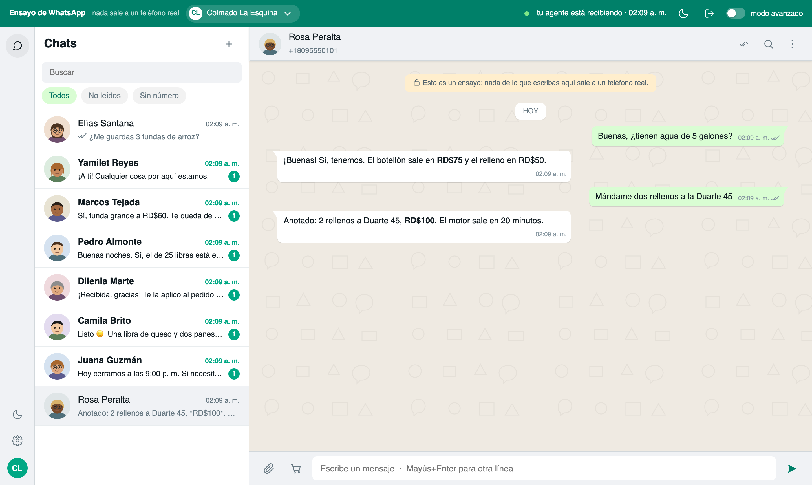
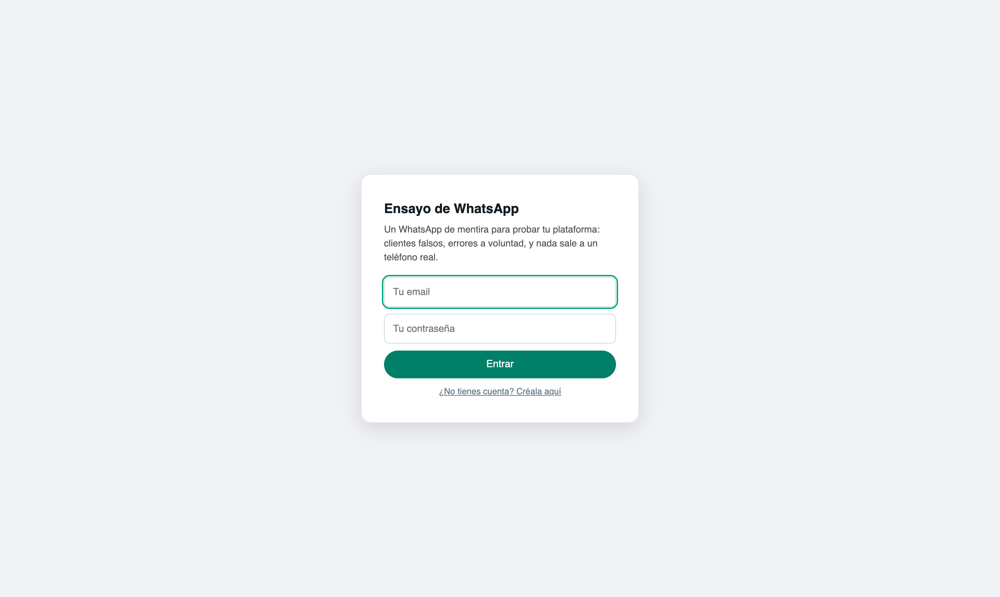
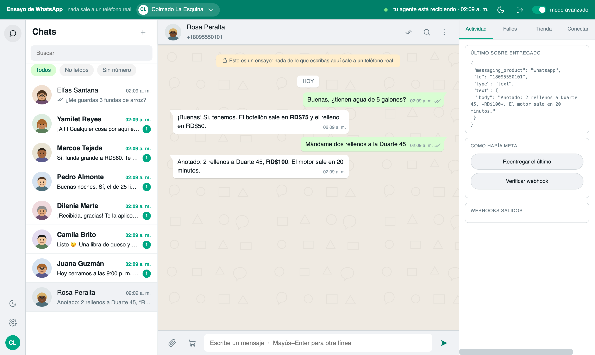

# wa-sandbox — un WhatsApp Cloud API de mentira

Un servidor que se hace pasar por el Graph API de WhatsApp de Meta. Tu
plataforma le apunta en vez de a `graph.facebook.com` y **no se entera de que es
mentira**: mismos endpoints, mismos campos, mismos códigos de error, webhooks
firmados igual. Encima trae una interfaz clavada a WhatsApp Web donde tú haces
de cliente.

Sirve para lo que con Meta no se puede: mandarle mil mensajes a tu agente sin
molestar a nadie, y provocar a voluntad los fallos que en producción solo
aparecen con un cliente delante.

```
┌──────────────┐   Graph API      ┌────────────┐   webhook firmado   ┌──────────────┐
│ tu plataforma│ ───────────────▶ │ wa-sandbox │ ──────────────────▶ │ tu plataforma│
└──────────────┘  (envíos)        └────────────┘   (lo que entra)    └──────────────┘
                                        ▲
                                        │ tú, haciendo de cliente
                                   interfaz web
```



## Qué es y qué no es

**Es** un doble del API para desarrollo y pruebas: implementa el contrato de
Meta con la fidelidad suficiente para que el código que funciona contra el
sandbox funcione contra Meta, y —esto importa más— para que **lo que falla
contra Meta también falle aquí**.

**No es** un WhatsApp alternativo. No manda mensajes a teléfonos, no se conecta
a la red de WhatsApp y no sirve para saltarse nada de Meta. Todo lo que escribes
se queda en tu servidor.

## Arrancar

Hace falta Node 20 o más nuevo.

```bash
npm install
npm start                 # http://localhost:8095
```

La primera vez se crea la base (`datos/sandbox.db`) y una clave de
administración en `datos/admin.clave`.

Abre `http://localhost:8095`, crea tu cuenta con email y contraseña, y ya
tienes tu primer negocio de ensayo con su número.



## Conectar tu plataforma

En la pestaña **Conectar** del sandbox tienes las credenciales, en el mismo
orden en que suelen pedirse:

| Dato | Qué es |
|---|---|
| `phone_number_id` | El número del negocio, como el de Meta |
| `access_token` | El Bearer de las llamadas al Graph |
| `app_secret` | Con él se firma el `X-Hub-Signature-256` de cada webhook |
| `verify_token` | El del apretón de manos de suscripción |
| `waba_id` | La cuenta de negocio, para plantillas y catálogo |

Y en tu plataforma, apunta la base del Graph al sandbox en vez de a Meta:

```
https://graph.facebook.com/v21.0   →   http://localhost:8095/v21.0
```

Cómo se hace eso depende de tu plataforma: una variable de entorno, un ajuste
por canal, lo que tengas. **Que sea configurable y no esté escrito a fuego es
media batalla**: si la única forma de apuntar al sandbox es editar código, en la
práctica nadie ensaya.

Del otro lado, dile al sandbox **dónde recibe tu plataforma los webhooks**
(«dónde avisar a tu agente»). Un aviso que ahorra una tarde: si tu plataforma
verifica la firma con un `app_secret` por canal, **cada negocio del sandbox
necesita su propio canal**; apuntar dos negocios al mismo webhook hace que la
firma no cuadre y verás 401.

## Cómo se usa

1. **Crea clientes falsos.** Marcando *«esconde su número»* llegan con `user_id`
   y sin `wa_id` — el caso de los nombres de usuario de WhatsApp, que rompe el
   guardado de contactos de más de una plataforma.
2. **Escríbele al negocio como si fueras el cliente.** El sandbox entrega el
   webhook firmado, tu agente responde de verdad, y su respuesta aparece en la
   conversación con sus acuses.
3. **Manda fotos, audios, documentos y carritos.** El carrito llega como llega
   de Meta: puros `product_retailer_id`, **sin nombres**. Si tu agente no sabe
   cruzarlos con el catálogo, acaba negándole al cliente lo que el cliente acaba
   de pedir.
4. **Aprueba o rechaza plantillas** cuando quieras, en vez de esperar a Meta.
5. **Provoca fallos a voluntad**: no entregado (131051, 131060), ventana de 24h
   vencida, número que no es de WhatsApp.

El **modo avanzado** (arriba a la derecha) enseña los sobres tal cual salen, el
registro de webhooks entregados con su código HTTP, y las credenciales.



## Qué imita, y con qué fidelidad

| | |
|---|---|
| `POST /{phone_number_id}/messages` | Responde `accepted` **antes** de entregar, como Meta: lo que falle después llega por webhook |
| Acuses `sent` → `delivered` → `read` | Escalonados de verdad, no los tres de golpe: la carrera entre el envío y su acuse es un fallo real |
| `X-Hub-Signature-256` | HMAC sobre el cuerpo crudo, con el app secret de la cuenta |
| Medios | Subir, pedir metadatos y descargar con token: el flujo de dos pasos de Meta, no un atajo |
| Errores | Con la forma de Meta (`error.code`, `error_data.details`), no un 400 pelado |
| Ventana de 24h | **Sola**: pasadas 24h del último mensaje del cliente, solo entran plantillas aprobadas. Es el fallo más común en producción |
| Plantillas | Nacen en `PENDING`; se comprueba que existan, estén aprobadas y que los `{{1}}` cuadren con los parámetros (132001 / 132000) |
| Reentrega duplicada | El mismo mensaje otra vez con su mismo id, como cuando Meta reintenta —hasta 7 días—. Ejercita el dedupe de tu plataforma |
| Reacciones y botones | El cliente reacciona a un mensaje o pulsa un botón: dos caminos que casi nadie prueba |
| Catálogo y carrito | `product_catalogs` y `products` se dejan leer —Meta se los niega a un negocio pequeño— y el cliente puede mandar un carrito |
| Verificación del webhook | El apretón de manos `hub.challenge` de la suscripción |
| Registro del número | El paso del PIN de Cloud API |
| Números | Se exige formato internacional con código de país, como Meta (131009): sin eso, un ensayo pasaría aquí y fallaría de verdad |
| Límites | 4096 caracteres por texto; un medio por `id` tiene que existir |

**Lo que NO imita:** la coexistencia con la app del teléfono (`history`,
`smb_message_echoes`), y lo que depende del juicio de Meta desde fuera —la
calificación de calidad del número, los límites por reputación—.

## Cuentas y aislamiento

Cada quien se registra solo (nombre del negocio, email y contraseña) y su
entorno nace con él. **Un negocio solo ve lo suyo**: el dueño sale de la clave
de sesión, nunca de un parámetro que mande el navegador, y todas las consultas
filtran por él.

Con el token de un negocio tampoco se llega a lo de otro: medios, plantillas,
catálogo y mensajes ajenos responden el mismo `Object with ID does not exist`
que devolvería Meta.

La **clave de administración** (`datos/admin.clave`, permisos 600) sirve solo
para dar de alta negocios, girar sus claves y eliminarlos. No abre ningún chat:
un descuido con ella no expone conversaciones.

```
http://localhost:8095/?clave=<clave de administración>
```

## Variables de entorno

Ninguna es obligatoria. También se leen de `datos/entorno.env`, que no va al
repositorio y sobrevive a los reinicios.

| Variable | Por defecto | Para qué |
|---|---|---|
| `PORT` | `8095` | Puerto |
| `SANDBOX_DB` | `datos/sandbox.db` | La base |
| `SANDBOX_MEDIOS` | `datos/medios` | Los archivos subidos |
| `SANDBOX_CARAS` | `datos/caras` | Fotos de perfil para los clientes de mentira (ver abajo) |
| `SANDBOX_ADMIN_CLAVE_ARCHIVO` | `datos/admin.clave` | Dónde vive la clave de administración |
| `SANDBOX_URL_PUBLICA` | el `Host` de la petición | La dirección con la que se arman las URLs de medios |
| `SANDBOX_WEBHOOK_DEFECTO` | vacío | La dirección de webhook que se propone al crear un negocio |
| `SANDBOX_RED_PRIVADA` | vacío | Ponla a `1` **en local**: deja entregar webhooks a `localhost` y a tu red. Sin ella solo entrega a direcciones públicas |

## Las caras de los clientes

Cada contacto tiene su retrato, **dibujado por el propio sandbox** en SVG: sale
de su número, así que es distinto para cada uno y siempre el mismo para él.
No se descarga nada de internet, y funciona sin conexión.

No se usan bancos de «fotos para datos de prueba» a propósito: los más
conocidos sirven fotos de **personas reales** con licencias mezcladas, y sus
propios términos dicen que son para maquetas, no para productos públicos. Si
quieres caras fotográficas, deja imágenes tuyas —o de licencia clara— en
`datos/caras/`; las que empiecen por `women-` o `men-` se reparten según el
nombre del contacto.

## Desplegarlo

Trae `Dockerfile` y `docker-compose.yml`:

```bash
docker compose up -d          # y queda en el 8095 de la red de docker
```

**En Dokploy** (o Coolify, Portainer…): crea una aplicación de tipo *Compose*
apuntando a este repositorio y expón el servicio `sandbox` en el puerto `8095`
desde su pestaña de dominios. El compose **no publica puertos a propósito**: en
un despliegue de verdad quien atiende desde fuera es el proxy, con su
certificado; un puerto abierto al mundo se salta ese proxy —y con él el HTTPS—.

Lo único que hay que conservar es el volumen `datos`: ahí viven la base, los
archivos subidos y la clave de administración. Sin él, cada despliegue empieza
de cero.

Un apunte: es un proceso Node con SQLite, así que **no se escala con réplicas**.
Si algún día hicieran falta, primero hay que sacar la base a otro sitio.

## Ponerlo en internet

Está pensado para que varias personas lo usen a la vez, pero antes de exponerlo:

- **HTTPS obligatorio.** La clave de sesión viaja en una cabecera (y en la query
  solo para el río de eventos, que no admite cabeceras). Sin TLS va en claro.
- **Ponlo detrás de un proxy** que corte peticiones enormes y ponga límites de
  ritmo en `/panel/entrar` y `/panel/registrar`.
- **No pongas `SANDBOX_RED_PRIVADA`.** El sandbox entrega webhooks a la
  dirección que escribe cada usuario, así que por defecto **solo entrega a
  direcciones públicas**: se comprueba la IP a la que resuelve el nombre (no el
  nombre, que se puede apuntar a donde sea) y no se siguen redirecciones. Sin
  eso, cualquiera que se registre lo usa de puente hacia tu red interna y de
  escáner de puertos. En local sí pon la variable: ahí apuntar a `localhost` es
  justo lo que quieres.
- **Respalda `datos/`**: ahí están la base, los archivos y la clave de
  administración.

## Las pruebas

Con el sandbox levantado:

```bash
npm run pruebas              # las tres de abajo, de una
node pruebas/aislamiento.mjs # que un negocio no llegue a lo de otro
node pruebas/telefonos.mjs   # números imposibles
node pruebas/limites.mjs     # 4096 caracteres, medios que no existen
```

`aislamiento.mjs` es la que más importa antes de exponerlo: toma las
credenciales BUENAS de un negocio y las usa contra los datos de otro —contactos,
mensajes, entregas, plantillas, catálogo, marcar leído, borrar— y comprueba que
todo responda como si no existiera.

Las de interfaz necesitan un Chrome escuchando por CDP:

```bash
chromium --remote-debugging-port=9333 &
node pruebas/interfaz.mjs
```

Y en `pruebas/con-plataforma/` están las que comprueban lo que de verdad
importa: que **tu plataforma entendiera** lo que el sandbox le mandó. Están
escritas contra una plataforma concreta y sirven de plantilla — el detalle, en
[pruebas/LEEME.md](pruebas/LEEME.md).

Las pruebas **leen las credenciales de la base**, no las llevan escritas: una
credencial copiada a mano caduca en cuanto se recrea el negocio, y entonces la
prueba falla por su culpa y no por la del código.

## Cómo está hecho

Sin framework, sin build, sin dependencias de más: Express, SQLite y multer.
La interfaz es un solo archivo servido tal cual.

```
src/graph.js      el clon del Graph API — aquí es donde tu plataforma cree que habla con Meta
src/webhooks.js   lo que sale hacia tu plataforma: firma, reintentos, acuses escalonados
src/panel.js      lo que Meta no tiene: crear clientes falsos y escribir como ellos
src/acceso.js     registro, entrada y el candado de cada ruta
src/meta.js       las formas exactas de Meta: wamid, sobres, errores
src/db.js         el esquema; todo cuelga de un `dueno`
public/index.html la interfaz entera
```

Una regla de la casa: en `src/graph.js`, **si Meta devuelve algo, aquí se
devuelve igual**. Cualquier atajo («total, mi plataforma solo lee el id»)
convierte el sandbox en una variante del mundo real, y entonces lo que se ensaya
no vale.

## Contribuir

Los comentarios del código explican **por qué** algo está escrito así, casi
siempre porque un fallo real lo enseñó. Si cambias una de esas líneas, cambia
también su porqué.

Antes de mandar un cambio: `node pruebas/meta-fiel.mjs` y las demás en verde.
Si el cambio toca fidelidad con Meta, trae su comprobación.

## Licencia

MIT — ver [LICENSE](LICENSE).

Este proyecto no está afiliado a Meta, WhatsApp ni ninguna de sus marcas: es un
doble para desarrollo, no un cliente de WhatsApp.
